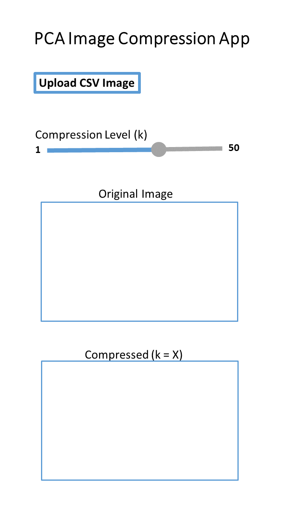

 
### My App Design

I designed a simple and minimalist vertical layout to make the interface easy to use. The structure is as follows:

- Title at the top

- Upload button placed directly under the title

- Slider for k placed below the upload button, with the value restricted to 1–50 for simplicity

- Two images stacked vertically: the original image displayed above the compressed image

This layout keeps the interface visually clear, clean, and intuitive for users, allowing them to interact with the controls at the top and view the results directly below.

### Mock-up Image

### Explanation of Mock-up Image

This webpage presents my mock-up image illustrating the layout of an interactive application that allows users to explore PCA-based image compression. The app includes three main features:

- The user can upload an arbitrary image.

- The user can select a compression level (a value of k).

- The user can view the compressed image alongside the original image.

